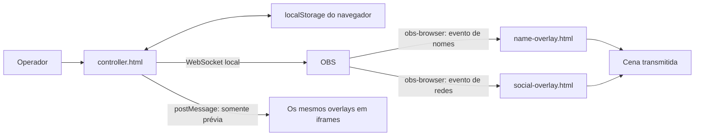

# Overlay Controller for OBS — documentação do projeto

Guia de operação e manutenção, baseado no código da versão v1.2.0, commit `9d4b250`. Preparado em 2 de outubro de 2026.

## 1. O que o projeto faz

O projeto exibe informações sobre o vídeo de uma transmissão no OBS. O operador cadastra pessoas e redes sociais em um painel e aciona a entrada ou saída dos gráficos. Esses gráficos são chamados de overlays; o cartão com o nome do pregador é um lower third.

Existem três páginas principais:

- `controller.html`: painel de operação, instalado como dock do OBS.
- `name-overlay.html`: fonte de navegador que exibe nome, cargo e Instagram da pessoa.
- `social-overlay.html`: fonte de navegador que exibe YouTube, Facebook e Instagram.

O painel não é a imagem transmitida. As duas fontes de navegador são as responsáveis por desenhar os gráficos sobre a cena.

O programa usa HTML, CSS e JavaScript, sem framework, servidor próprio ou banco de dados. Não existe etapa de compilação. O navegador incorporado no OBS executa os arquivos locais; o servidor WebSocket do próprio OBS recebe os comandos. Node.js, Python e Playwright não são necessários para operar a transmissão. Node.js e Playwright são usados nos testes de desenvolvimento.

## 2. Pastas usadas neste projeto

| Local                                     | Finalidade                                    |
| ----------------------------------------- | --------------------------------------------- |
| `C:\repos\overlay-controller-for-obs`     | Código-fonte, desenvolvimento e operações Git |
| `C:\OBSIgreja\overlay-controller-for-obs` | Cópia usada para testar e operar no OBS       |

Alterar uma pasta não atualiza a outra automaticamente. A cópia para a pasta do OBS precisa ser feita após as alterações que serão testadas.

Os três caminhos esperados na instalação atual são:

```text
Dock:
file:///C:/OBSIgreja/overlay-controller-for-obs/controller.html

Fonte de nomes:
C:\OBSIgreja\overlay-controller-for-obs\name-overlay.html

Fonte de redes:
C:\OBSIgreja\overlay-controller-for-obs\social-overlay.html
```

Já houve um caso em que a prévia estava correta, mas a fonte Nome apontava para uma pasta antiga com `v1.0` no caminho. Por isso, o caminho configurado em cada fonte é uma das primeiras verificações quando os resultados diferem.

## 3. Como as partes se comunicam



### Exemplo: colocar um pregador no ar

1. O operador clica no botão de reprodução ou no nome da pessoa.
2. `toggleName()` verifica se a conexão com o OBS está pronta.
3. `payload()` reúne os dados da pessoa e as configurações visuais salvas.
4. `emit()` envia uma requisição `CallVendorRequest` ao OBS, direcionada a `obs-browser`, com `requestType: emit_event`.
5. A página de nomes recebe o evento `oocLowerThirdShow` pelo objeto `window`.
6. `show()` aplica o tema, preenche os textos, seleciona o modelo e inicia a animação.
7. Um temporizador oculta o gráfico ao terminar a duração configurada. O operador também pode clicar novamente para ocultá-lo antes.

O overlay de redes usa o mesmo caminho, com eventos próprios.

### Eventos existentes

| Evento              | Consumidor            | Efeito                    |
| ------------------- | --------------------- | ------------------------- |
| `oocLowerThirdShow` | `name-overlay.html`   | Atualiza e exibe a pessoa |
| `oocLowerThirdHide` | `name-overlay.html`   | Oculta a pessoa           |
| `oocSocialShow`     | `social-overlay.html` | Atualiza e exibe as redes |
| `oocSocialHide`     | `social-overlay.html` | Oculta as redes           |

O conteúdo chega em `event.detail`. `_settings` contém o tema completo. O painel também inclui `_ws`, mas os overlays atuais não abrem uma conexão WebSocket a partir desse campo.

Os comandos não identificam uma fonte pelo nome cadastrado no OBS. O roteamento depende dos eventos recebidos pelas páginas do `obs-browser`; não existe filtro próprio por cena ou instância. Evite duplicar páginas receptoras esperando controles independentes.

### Conexão e indicação de estado

O endereço padrão é `ws://127.0.0.1:4455`, usando o subprotocolo `obswebsocket.json`. O código identifica a sessão com `rpcVersion: 1`, sem assinar eventos gerais do OBS. Se o servidor exigir autenticação, o painel informa essa condição e encerra a tentativa: ainda não existe implementação de senha.

Após uma desconexão, as tentativas usam intervalos progressivos: 2, 4, 8, 16 e até 30 segundos. `connectGeneration` impede que callbacks de conexões antigas alterem a sessão atual.

A indicação “no ar” no painel é local. Ela é atualizada por cliques e temporizadores, com margens de 1,2 segundo para nomes e 1,8 segundo para redes. Não é uma confirmação de que o gráfico está visível na saída final do OBS.

## 4. Mapa de todos os arquivos

| Arquivo                 | Responsabilidade                                                                                                                  | Quando editar                                                        |
| ----------------------- | --------------------------------------------------------------------------------------------------------------------------------- | -------------------------------------------------------------------- |
| `controller.html`       | Estrutura e CSS do painel; cadastro de pessoas e redes; traduções básicas; configuração; armazenamento; conexão e comandos do OBS | Alterar a operação do painel, campos básicos, idioma ou comunicação  |
| `name-overlay.html`     | Estrutura do nome, cargo, Instagram e logo; estilos e animações básicos; eventos de entrada e saída                               | Alterar o conteúdo ou comportamento da fonte de nomes                |
| `social-overlay.html`   | Estrutura das três redes, SVGs dos ícones, animações e eventos                                                                    | Alterar as redes exibidas ou seu comportamento                       |
| `name-layout.js`        | Mede o texto renderizado, amplia o cartão até 1728 px e ajusta a fonte até 32 px quando habilitado                                | Alterar o ajuste de nomes longos                                     |
| `test-name-layout.cjs`  | Regressão de nomes longos, fontes, posições, campos opcionais e persistência                                                      | Validar o ajuste de nomes                                            |
| `themes.js`             | API global `OverlayThemes`; valores padrão, temas de cores, normalização e aplicação de variáveis CSS                             | Acrescentar propriedades visuais, temas ou regras de compatibilidade |
| `themes.css`            | Aparência compartilhada: fundos, cores, opacidade, textos, cantos e detalhes do Clássico                                          | Alterar a aparência comum sem mudar a estrutura dos modelos          |
| `overlay-models.css`    | Layouts Faixa lateral, Identidade e Cápsula, selecionados por atributos no elemento `html`                                        | Alterar ou acrescentar uma composição de overlay                     |
| `theme-editor.js`       | Insere o módulo visual no painel; seletores, upload de imagens e logo, prévia e integração com salvar configurações               | Expor opções visuais ao operador                                     |
| `settings-modules.js`   | Transforma as seções em módulos recolhíveis; acessibilidade, expandir/recolher tudo e memória de abertura                         | Alterar a navegação das configurações                                |
| `test-themes.cjs`       | Testes no navegador para temas, prévia, imagens, persistência e migração                                                          | Validar alterações no tema ou configuração                           |
| `test-models.cjs`       | Testes para modelos, logo, independência das cores, importação, posicionamento e eventos                                          | Validar novos layouts ou alterações no modelo                        |
| `README.md`             | Apresentação pública, instalação e uso resumido em inglês e português                                                             | Atualizar instruções de entrada no projeto                           |
| `DOCUMENTACAO.pt-BR.md` | Este guia detalhado para entender e manter o projeto                                                                              | Registrar alterações de arquitetura e operação                       |
| `CHANGELOG.md`          | Histórico textual das mudanças                                                                                                    | Registrar funcionalidades e correções por versão                     |
| `LICENSE`               | Arquivo da licença MIT do projeto                                                                                                 | Consultar os termos do código distribuído                            |
| `.prettierrc.json`      | Padrão de formatação do Prettier                                                                                                  | Ajustar regras de formatação do repositório                          |
| `.editorconfig`         | UTF-8, dois espaços, LF e regras básicas para editores                                                                            | Manter consistência entre ambientes de edição                        |
| `.gitattributes`        | Normalização de arquivos de texto com finais de linha LF no Git                                                                   | Controlar o tratamento de finais de linha                            |

A pasta oculta `.git` contém o histórico e os metadados do repositório. Não é uma dependência da aplicação e não precisa ser copiada para executar no OBS.

### Arquivos necessários para executar

Mantenha os três HTMLs e estes seis arquivos juntos: `themes.js`, `name-layout.js`, `themes.css`, `overlay-models.css`, `theme-editor.js` e `settings-modules.js`.

Os arquivos de teste, documentação e configuração do editor não são carregados pela aplicação. Os ícones sociais são SVGs embutidos no HTML; não dependem de downloads externos. Logo e fundo enviados pelo painel ficam incorporados à configuração.

### Ordem de carregamento

No controlador, a sequência é:

```text
themes.js
  → script interno de controller.html
  → theme-editor.js
  → settings-modules.js
```

O editor visual depende de variáveis e funções globais do controlador, como `cfg`, `$`, `I18N`, `fillSettings()` e `applyI18n()`. Ele amplia o preenchimento e o salvamento das configurações. O script dos módulos deve executar por último para incluir a seção inserida pelo editor visual.

Nos overlays, os estilos internos definem a base; `themes.css` aplica a aparência comum; `overlay-models.css` sobrescreve o layout quando necessário. `themes.js` precisa estar carregado antes de chamar `show()`.

## 5. Modelo e tema são escolhas diferentes

O **modelo** define a composição. O **tema** define a aparência dessa composição.

| Uso   | Valor interno | Nome na interface   | Estrutura                                          |
| ----- | ------------- | ------------------- | -------------------------------------------------- |
| Nomes | `classic`     | Clássico            | Nome em cima e cartão com cargo/Instagram embaixo  |
| Nomes | `sidebar`     | Faixa lateral       | Um bloco, textos à esquerda e destaque vertical    |
| Nomes | `identity`    | Identidade com logo | Logo ou símbolo decorativo ao lado das informações |
| Redes | `classic`     | Clássico            | Três cartões com blocos coloridos para os ícones   |
| Redes | `capsule`     | Cápsula             | Faixas arredondadas com ícones circulares          |

Os temas de cores são `classic`, `midnight`, `minimal` e `light`. `custom` identifica ajustes personalizados no painel. Trocar o tema de cores preserva o modelo escolhido e o logo.

`OverlayThemes.apply()` escreve variáveis como `--surface-color`, `--surface-image`, `--theme-text` e `--theme-radius`, além destes atributos no elemento `html`:

- `data-name-model`: composição de nomes.
- `data-social-model`: composição de redes.
- `data-name-style`: fundo do nome combinado ou independente.
- `data-transparent`: seleção de fundo transparente.

O CSS usa esses atributos para escolher as regras adequadas. Os modelos atuais reaproveitam a estrutura dos HTMLs, reorganizando os elementos pelo CSS; não são páginas separadas por modelo.

### Diferenças importantes

- No Clássico, `nameStyle: matched` acompanha o cartão inferior; `custom` permite fundo sólido e cor de texto próprios para o nome.
- Faixa lateral e Identidade usam uma superfície única. Os controles de fundo independente do nome ficam ocultos nesses modelos.
- No modo Cápsula, redes sem texto saem do layout e o espaço é redistribuído. No Clássico, a rede vazia fica invisível, mas conserva sua coluna.
- A opção de brilho é usada nas superfícies clássicas. Nem todo modelo utiliza todos os efeitos do tema: a Cápsula, por exemplo, tem arredondamento próprio.
- Nomes e redes compartilham cores, fonte, fundo e duração. A escolha dos dois modelos é independente, mas ainda não há um tema de cores separado para cada fonte.

## 6. Configuração e armazenamento

O objeto principal se chama `cfg` e tem seis campos principais:

| Grupo      | Conteúdo                                                        |
| ---------- | --------------------------------------------------------------- |
| `version`  | Campo de versão mantido no JSON; o padrão atual ainda é `1.0.0` |
| `language` | `en`, `pt-BR` ou `auto`                                         |
| `people`   | Lista de objetos com `name`, `role` e `instagram`               |
| `social`   | Textos `youtube`, `facebook` e `instagram`                      |
| `theme`    | Modelo, cores, fundos, imagens e dimensões                      |
| `ws`       | Host e porta do OBS                                             |

O campo `version` não acompanha automaticamente as releases do GitHub e não deve ser usado para descobrir a versão do código instalado. Consulte a release ou o commit de origem.

### Exemplo reduzido de JSON

Os campos visuais omitidos são completados com valores padrão durante a normalização.

```json
{
  "version": "1.0.0",
  "language": "pt-BR",
  "people": [
    {
      "name": "Pr. João da Silva",
      "role": "Pregador",
      "instagram": "joaodasilva"
    }
  ],
  "social": {
    "youtube": "Igreja Exemplo",
    "facebook": "Igreja Exemplo",
    "instagram": "igrejaexemplo"
  },
  "theme": {
    "preset": "midnight",
    "nameModel": "identity",
    "socialModel": "capsule",
    "duration": 30,
    "nameWidth": 700,
    "namePosition": "left",
    "background": "solid",
    "backgroundColor": "#172554",
    "textColor": "#FFFFFF",
    "logoImage": ""
  },
  "ws": {
    "host": "127.0.0.1",
    "port": "4455"
  }
}
```

### Propriedades visuais

| Campo                              | Uso ou valores aceitos                                                                         |
| ---------------------------------- | ---------------------------------------------------------------------------------------------- |
| `preset`                           | Identificação do tema de cores                                                                 |
| `nameModel`, `socialModel`         | Identificadores dos modelos da tabela anterior                                                 |
| `duration`                         | De 3 a 300 segundos; padrão 30                                                                 |
| `font`                             | Família tipográfica CSS; o painel oferece fontes do sistema                                    |
| `nameWidth`                        | De 420 a 1728 pixels; padrão 700                                                               |
| `nameAutoFit`                      | Expansão e ajuste de fonte opcionais; padrão desligado para preservar configurações anteriores |
| `namePosition`                     | `left`, `center` ou `right`                                                                    |
| `nameShadow`                       | Ativa ou desativa a sombra do texto do nome                                                    |
| `primary`                          | Destaque de cor do painel; também participa da compatibilidade com configurações antigas       |
| `secondary`                        | Detalhes decorativos do overlay                                                                |
| `textColor`                        | Cor dos textos dos cartões                                                                     |
| `nameStyle`                        | `matched` ou `custom`, para o Clássico                                                         |
| `nameColor`, `nameBackgroundColor` | Cores próprias do nome no estilo personalizado                                                 |
| `background`                       | `solid`, `gradient`, `transparent` ou `image`                                                  |
| `backgroundColor`, `backgroundEnd` | Cor base e cor final do degradê                                                                |
| `backgroundAngle`                  | De 0 a 360 graus                                                                               |
| `backgroundOpacity`                | De 0 a 100; afeta a superfície, não a opacidade do texto                                       |
| `backgroundImage`                  | Imagem incorporada como data URL                                                               |
| `imageFit`                         | `cover` para preencher com recorte; `contain` para mostrar a imagem inteira                    |
| `radius`                           | De 0 a 40 pixels, nos elementos que usam o raio configurável                                   |
| `shine`                            | Controle do brilho animado nas superfícies que implementam o efeito                            |
| `logoImage`                        | Logo incorporado como data URL para Identidade                                                 |

### Onde os dados ficam

O controlador grava no `localStorage` do navegador que o executa:

```text
overlay-controller-for-obs-v1
overlay-controller-for-obs-v1-settings-modules
```

A primeira chave contém a configuração principal; a segunda contém o estado aberto/fechado dos módulos. A exportação JSON inclui a primeira configuração, mas não a memória de abertura dos módulos.

Abrir o controlador no Edge e abri-lo no dock do OBS não implica compartilhar configurações. O armazenamento pertence ao ambiente do navegador; a pasta do projeto não contém um arquivo automático com o cadastro do operador. Para transportar os dados, use exportação e importação JSON.

Pessoas e redes são persistidas ao salvar seus respectivos editores. O idioma é persistido ao ser alterado. As opções visuais são exibidas na prévia durante a edição, mas dependem de **Salvar configurações** para serem usadas nos próximos acionamentos do OBS.

### Imagens e compatibilidade

O upload aceita PNG, JPEG e WebP de até 1 MiB por arquivo, apresentado na interface como 1 MB. O painel lê a imagem e a armazena em base64, sem precisar manter seu arquivo original no mesmo caminho. Isso também aumenta o tamanho do JSON exportado.

`OverlayThemes.normalize()` limita números, valida cores hexadecimais de seis dígitos e restringe data URLs de imagens. Valores de modelo desconhecidos voltam ao Clássico. `normalizePerson()` aceita os campos antigos `nome` e `cargo`.

A normalização não é um validador completo de qualquer JSON arbitrário. A importação exige os grupos `people`, `social` e `theme`, mas não verifica exaustivamente todos os tipos de dados. Prefira arquivos exportados pelo próprio programa.

## 7. Prévia e transmissão real

O painel carrega os mesmos HTMLs em dois iframes, acrescentando `?preview` ao endereço. `updateThemePreview()` envia `postMessage` com o tipo `overlay-preview`. Os overlays só aceitam esse caminho quando o parâmetro de prévia existe e a mensagem vem do pai do iframe.

A prévia usa a primeira pessoa cadastrada e os textos das redes. Sua duração é definida em 300 segundos a cada atualização. O conteúdo de 1920×250 é reduzido visualmente para caber no dock, usando `ResizeObserver`.

Na transmissão real, o acionamento chega pelo evento do OBS, sem depender do iframe. Uma prévia correta demonstra que os arquivos locais conseguem renderizar, mas não verifica o caminho da fonte, a conexão WebSocket, a posição na cena ou as configurações já salvas no dock.

## 8. Operação no OBS

1. Mantenha todos os arquivos de execução na mesma pasta permanente.
2. Configure o dock com o endereço de `controller.html`.
3. Configure as fontes de nomes e redes com seus respectivos arquivos locais e dimensões de 1920×250.
4. Posicione as fontes sobre a câmera na cena. Elas devem permanecer carregadas para receber os comandos; os gráficos ficam transparentes quando ocultos pelo controlador.
5. Use o servidor WebSocket local na porta configurada no painel. Esta implementação espera autenticação desativada e deve ficar restrita ao ambiente local.
6. Em **Geral**, escolha idioma, duração e fonte.
7. Em **Modelos, temas e fundo**, configure aparência, modelo e logo, quando aplicável.
8. Salve e use os botões das abas de nomes ou redes para mostrar e ocultar o conteúdo.

Recolher um módulo apenas esconde seus controles, sem remover os campos da página nem perder alterações em edição. O primeiro módulo é Geral; todos começam recolhidos quando não há estado salvo. O botão de salvar permanece acessível durante a rolagem.

## 9. Como alterar o projeto

### Mudar uma cor padrão

Edite `defaults` ou uma entrada de `presets` em `themes.js`. Os valores já salvos pelo operador podem continuar prevalecendo. Para observar o novo preset, selecione-o novamente no painel e salve.

### Adicionar um tema de cores

1. Acrescente uma entrada em `OverlayThemes.presets`.
2. Inclua a opção no seletor `preset` de `theme-editor.js`.
3. Acrescente os rótulos em inglês e português.
4. Verifique contraste e prévia em todos os modelos.

### Adicionar um modelo

1. Defina a composição e quais campos ela usa.
2. Registre o identificador permitido em `normalize()` de `themes.js`.
3. Acrescente opção e tradução em `theme-editor.js`.
4. Implemente regras em `overlay-models.css`, usando `data-name-model` ou `data-social-model`.
5. Se a estrutura atual for insuficiente, adicione os elementos necessários ao HTML correspondente e preencha-os em `show()`.
6. Preserve o Clássico como fallback e evite mudanças nos nomes dos eventos existentes.
7. Adicione verificação em `test-models.cjs`, incluindo troca de modelos, saída e conteúdo vazio.

### Acrescentar uma opção visual

O caminho completo normalmente passa por: valor padrão e normalização em `themes.js`; controle e leitura em `theme-editor.js`; aplicação em `apply()`; uso da variável no CSS. O editor usa `extraFields` para ler e preencher vários controles automaticamente.

### Alterar conexão com o OBS

Revise `connect()`, `schedule()`, `restartConnection()`, `req()` e `emit()` em `controller.html`. Não basta adicionar um campo de senha: o protocolo de autenticação precisaria ser implementado. Uma alteração nesse fluxo exige validação com uma instância real do OBS.

## 10. Formatação e testes

O padrão do repositório é UTF-8, dois espaços, finais de linha LF e fonte legível, sem minificação. Execute na pasta do repositório:

```powershell
npx --yes prettier@3.6.2 --write .
npx --yes prettier@3.6.2 --check .
git diff --check
```

O Prettier pode precisar de rede na primeira execução. O projeto não tem `package.json`, lockfile ou scripts npm próprios.

Os testes precisam de Node.js, do pacote `playwright` disponível para `require()` e do Microsoft Edge instalado:

```powershell
node test-themes.cjs
node test-models.cjs
```

Se o pacote estiver instalado em uma pasta de ferramentas, configure `NODE_PATH` para essa pasta de `node_modules`. Para usar Google Chrome instalado no lugar do Edge:

```powershell
$env:TEST_BROWSER = 'chrome'
node test-themes.cjs
node test-models.cjs
```

| Teste             | Cobertura principal                                                                                                             |
| ----------------- | ------------------------------------------------------------------------------------------------------------------------------- |
| `test-themes.cjs` | Temas, prévia, opacidade, transparência, cores e ícones sociais, imagem de fundo, persistência, importação e compatibilidade    |
| `test-models.cjs` | Escolha independente de modelos, upload/remoção de logo, salvamento, importação, fallback, posição e eventos de mostrar/ocultar |

Os testes abrem o navegador sem janela e usam configurações isoladas da sessão do OBS. As capturas de tela de verificação são gravadas na pasta temporária do sistema. Eles disparam eventos equivalentes aos recebidos pelos overlays, mas não exercitam uma conexão real com o OBS nem inspecionam a transmissão.

Antes de considerar uma alteração pronta, confira também uma cena real: nomes longos, câmera clara e escura, logo, redes vazias, posição, entrada, saída e atualização após salvar.

## 11. Atualização, Git e releases

Fluxo recomendado para uma mudança:

1. Edite os arquivos em `C:\repos\overlay-controller-for-obs`.
2. Formate e execute as verificações relacionadas à alteração.
3. Exporte o JSON do dock para manter uma cópia dos dados do operador.
4. Copie os arquivos necessários para a pasta do OBS, preservando seus arquivos extras.
5. Recarregue o dock e as fontes e valide na cena.
6. Revise o diff e faça commit/push quando a alteração estiver pronta.
7. Para distribuir uma versão, crie uma tag/release vinculada ao commit e um ZIP com todos os arquivos necessários.

As releases publicadas até a preparação deste guia são:

| Release                                                                               | Commit    | Conteúdo                            |
| ------------------------------------------------------------------------------------- | --------- | ----------------------------------- |
| [v1.0.0](https://github.com/thaylorcs/overlay-controller-for-obs/releases/tag/v1.0.0) | `fbc7816` | Versão inicial                      |
| [v1.1.0](https://github.com/thaylorcs/overlay-controller-for-obs/releases/tag/v1.1.0) | `703ff69` | Temas, fundos e módulos recolhíveis |
| [v1.2.0](https://github.com/thaylorcs/overlay-controller-for-obs/releases/tag/v1.2.0) | `9d4b250` | Modelos independentes e logo        |

As notas das releases estão em inglês primeiro e português do Brasil depois. A publicação de releases e a cópia para o OBS foram feitas como operações de manutenção; não há workflow de publicação automática no repositório. O `CHANGELOG.md` ainda reúne as mudanças recentes em `Unreleased`, portanto não está totalmente separado pelas tags publicadas.

## 12. Diagnóstico rápido

| Sintoma                                                   | O que conferir                                                                                                                                               |
| --------------------------------------------------------- | ------------------------------------------------------------------------------------------------------------------------------------------------------------ |
| Prévia correta, OBS com visual antigo                     | Caminho local da fonte; cópia dos CSS/JS; recarga da fonte; configurações salvas no dock                                                                     |
| Painel em “Reconectando”                                  | OBS aberto; servidor WebSocket ativo; host e porta; restrições locais de conexão                                                                             |
| Aviso de autenticação                                     | O cliente atual não implementa senha do OBS WebSocket                                                                                                        |
| Overlay não aparece                                       | Fonte carregada, visível e posicionada na cena; conexão pronta; erro de comando no painel                                                                    |
| Mudança aparece na prévia, mas não no próximo acionamento | Clicar em Salvar configurações; verificar se o dock editado é o mesmo que aciona o OBS                                                                       |
| Cadastro parece ter sumido                                | Outro navegador, outro contexto local ou armazenamento limpo; importar o JSON de backup                                                                      |
| Logo não aparece                                          | Modelo Identidade selecionado; formato/tamanho aceitos; logo salvo; símbolo decorativo indica ausência ou falha da imagem                                    |
| Nome cortado                                              | Largura do cartão e tamanho do texto; ative o ajuste automático, que amplia o cartão e reduz a fonte até 32 px; textos maiores ainda podem exigir abreviação |
| Um espaço vazio entre redes                               | No Clássico a coluna vazia é preservada; a Cápsula redistribui o espaço                                                                                      |
| Falha ao salvar com imagens                               | Tamanho das imagens e disponibilidade de espaço no armazenamento do navegador                                                                                |

## 13. Limites atuais e pontos de evolução

Não há autenticação WebSocket, sincronização em nuvem, controle independente por cena, confirmação visual de exibição, escolha de fonte via upload ou editor livre de layout. A transparência escolhida pelo operador pode reduzir a legibilidade; não existe verificação automática de contraste.

O código está separado por responsabilidades, mas ainda depende de variáveis globais e de scripts internos nos HTMLs. Uma evolução maior pode extrair o controlador para módulos JavaScript, formalizar o esquema de configuração, melhorar a validação de importações e separar as versões do formato JSON das versões de release.

Para se localizar rapidamente: comece por `controller.html` para entender a operação, siga para `themes.js` para entender os dados visuais e depois leia o HTML do overlay junto de `themes.css` e `overlay-models.css` para entender o resultado na tela.
