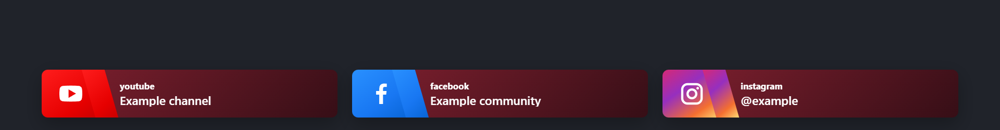
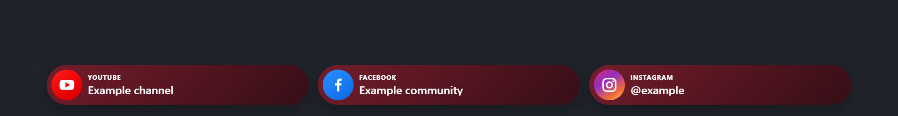
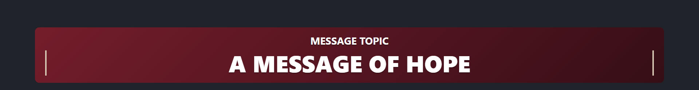

# Overlay Controller for OBS

A free, local overlay controller for OBS Studio. Operate animated presenter names, social networks, and a service/talk topic from a Custom Browser Dock. No backend, build step, or external runtime packages are required.

[Português (Brasil)](#português-brasil) · [Detailed Portuguese guide](DOCUMENTACAO.pt-BR.md) · [Changelog](CHANGELOG.md) · [Releases](https://github.com/thaylorcs/overlay-controller-for-obs/releases)

## Download and compatibility

- **Development source:** [download the master ZIP](https://github.com/thaylorcs/overlay-controller-for-obs/archive/refs/heads/master.zip), or clone this repository. The branch archive changes as development continues.
- **Latest release: [v1.3.0](https://github.com/thaylorcs/overlay-controller-for-obs/releases/tag/v1.3.0)** ([installation ZIP](https://github.com/thaylorcs/overlay-controller-for-obs/releases/download/v1.3.0/overlay-controller-for-obs-v1.3.0.zip)). Includes Topic, its optional editable heading, timing/speed controls, and automatic long-name fitting. Releases through v1.2.0 do not include these features.

The application requires OBS Browser Sources, Custom Browser Docks, and the OBS WebSocket v5 protocol. The local operator reported successful overlay use with the current source; the local OBS log identifies **OBS Studio 33.0.1 on Windows**. This is an observed environment, not a minimum-version guarantee or a complete compatibility matrix. Automated browser checks use Playwright with Microsoft Edge; they do not establish OBS compatibility on other versions or operating systems.

## Installation

1. Extract all files into a permanent folder.
2. In OBS, enable the WebSocket server on port **4455**. This client expects authentication disabled and a local connection to **127.0.0.1**; it cannot authenticate with a password. Keep access restricted to the local machine.
3. Add `controller.html` as a **Custom Browser Dock** using its `file:///...` URL. Recommended dock width: **380 px or more**.
4. Add the following **Browser Sources**, selecting **Local file**. Set each source to **1920×250**:

   | Source          | Local file            | Content                                           |
   | --------------- | --------------------- | ------------------------------------------------- |
   | Presenter names | `name-overlay.html`   | Name, role, optional Instagram and layout logo    |
   | Social networks | `social-overlay.html` | YouTube, Facebook and Instagram                   |
   | Topic           | `topic-overlay.html`  | Message, optional heading and automatic scrolling |

5. Keep the sources enabled and loaded so they can receive commands. Position them in the scene as needed; they remain transparent until triggered. Separate sources can overlap if placed at the same position.
6. Wait for **Ready** in the dock, select **Names**, **Social**, or **Topic**, and show the desired content. Use the same controls to hide it sooner.

For example, a folder at `C:\OBSIgreja\overlay-controller-for-obs` uses `file:///C:/OBSIgreja/overlay-controller-for-obs/controller.html` for the dock. Every source must point to files in that same installation.

### Required runtime files

Keep all **11 files** together. Copy them as a set when installing or updating:

```text
controller.html
name-overlay.html
social-overlay.html
topic-overlay.html
themes.js
themes.css
name-layout.js
overlay-models.css
theme-editor.js
settings-modules.js
topic-settings.js
```

No Node.js, Python, Playwright or npm installation is needed to run the overlays. Documentation, screenshots, tests, `.git`, `AGENTS.md`, and `node_modules` are not runtime requirements. Social icons are embedded SVGs; uploaded logos/backgrounds are stored in the configuration.

## Operation and saving

English is the default interface language. Select Brazilian Portuguese in **Settings > General > Language**. Settings modules can be expanded or collapsed without discarding edits; their open state is remembered locally.

In **Names**, click the pencil beside a presenter to open the editor directly below that person. The **+** button opens a blank editor above the list.

The dock displays one overlay type at a time. When you switch between names, social networks, and the topic, the outgoing overlay plays its exit animation, followed by at least half a second before the next overlay starts. If you click several items during the transition, the last selection wins.

The countdown stays at the top of the dock as you scroll. It starts when the dock shows the overlay and uses its configured display time. Names and social networks use the shared duration. The topic uses its effective shared, automatic, or manual duration. If a scrolling topic finishes early, the countdown still follows the configured time.

The countdown defaults to amber (`#FFCE68`). Choose **Countdown color** under **Settings > Models, themes & background**, then click **Save settings**. The color is included in backups and is preserved when changing the appearance preset.

| Action                                               | What is saved or applied                                                                                                    |
| ---------------------------------------------------- | --------------------------------------------------------------------------------------------------------------------------- |
| Save a person or social editor                       | Saves that editor's values to local browser storage                                                                         |
| Change the interface language                        | Saves immediately                                                                                                           |
| Edit appearance, font, shared duration or connection | Appearance previews update while editing; click **Save settings** to persist and use the settings on the next trigger       |
| Save in Topic                                        | Saves message, heading, heading switch, timing and speed; when already on air, updates the message and restarts its display |
| Show topic                                           | Saves the current Topic fields and starts a new display                                                                     |
| Export JSON                                          | Downloads the currently saved configuration, including images and topic options; unsaved form edits are not included        |
| Import JSON                                          | Replaces and saves the configuration immediately, refreshes fields, and restarts the connection; no extra Save is required  |

Use **Settings > Backup** to export before updates or imports. Use backups produced by the application: import validation is not yet exhaustive for arbitrary JSON. If an import fails, do not assume the previous state was preserved; retain your known-good backup ([#1](https://github.com/thaylorcs/overlay-controller-for-obs/issues/1)).

Data belongs to the browser context, not an automatic file in the installation folder. Edge and the OBS dock have separate storage. To transfer settings or restore a known-good configuration, open **Import JSON** in the target dock and select the exported file. The backup includes saved settings, people, networks, embedded images, topic and heading; it excludes the live display state and expanded/collapsed module state. The JSON `version` field remains `1.0.0`; it is not the installed source/release version.

## Layouts and appearance

In **Settings > Models, themes & background**, select layouts independently of color themes. New installations use Classic; updates preserve saved layout choices. Choose Classic, Midnight, Minimal or Light as a starting point, then customize the shared font, text colors, decorative accent, solid/gradient/transparent/image background, opacity and corners. Opacity affects the surface rather than text. Shine is used only by layouts that implement it.

Background images and the Identity logo accept local PNG, JPEG or WebP files up to **1 MB (1 MiB)** each. They are embedded in local storage and JSON backups. **Cover** fills with cropping; **Contain** shows the complete image over the background color. Identity displays a decorative symbol when no logo is provided.

| Layout                   | Choose it when                                                                 | Browser-source example                                                       |
| ------------------------ | ------------------------------------------------------------------------------ | ---------------------------------------------------------------------------- |
| Name: Classic            | You want a name plate above a separate role/Instagram card                     |                     |
| Name: Sidebar            | You want a single panel with left-aligned text and a vertical accent           |                     |
| Name: Identity with logo | You want a logo or decorative symbol beside the speaker details                |  |
| Social: Classic          | You want three separate cards; empty networks retain their columns             |                      |
| Social: Capsule          | You want rounded pills; empty networks are removed and the space redistributed |                      |

These are screenshots of the actual browser sources with sample data, a neutral illustrative background, and a common wine color scheme; they are not captures of an OBS broadcast. The layout and color theme are separate choices.

Both social layouts label the networks **YouTube**, **Facebook**, and **Instagram**. Account names keep the capitalization you entered.

Classic names default to **Presenter style > Match lower card (default)**: both panels share width, surface, colors and decoration. **Custom** enables an independent opaque name background/text color. Sidebar and Identity use one shared surface.

The editor's live preview works without OBS and shows the first saved person and saved social labels. **There is no Topic preview yet.** Save settings and trigger again to check the real source. A working preview does not confirm the OBS source path, visibility or connection.

### Long presenter names

Name width supports **420–1728 px**, default **700 px**, on the 1920×250 source. Enable **Automatically fit long names** to expand from the saved width up to the maximum, then reduce only the name font to a minimum of **32 px**. Short names keep the saved width. The choice defaults to off for older configurations.

Fitting uses the actual rendered font. There is no wrapping or source-height change. If text still does not fit, it receives an ellipsis and the live preview warns about its displayed person. Increase the width, abbreviate the name or select a narrower font. The maximum width leaves 96 px margins on each side of a 1920 px source.

## Topic

Open **Topic**, enter the service/talk message, and click **Show topic**. It uses the saved presenter font and shared surface/text colors. Text that fits stays centered; longer text scrolls left once, with measurements recalculated after font loading or resizing.



- **Show message heading:** a switch enables the static, editable heading above the message. Its initial text is currently `Tema da mensagem`, even with the English interface. Replace it as needed; disabling the switch preserves the text. Long headings use an ellipsis to keep the source within 1920×250.
- **Use topic duration off:** uses the shared overlay duration (**3–300 seconds**, default **30**).
- **Use topic duration on:** select **Manual** (**3–3600 seconds**) or **Automatic (character count)**. Automatic timing estimates reading at 15 characters/second at the normal speed, reserves travel distance using 1728 px plus 64 px per character, adds 3 seconds, and accounts for the selected speed. The result is shown in the dock and capped at one hour; it is an estimate, not a guarantee of reading time.
- **Scroll speed:** **40–480 px/s**, default **160 px/s**. Larger values move faster. Speed changes do not change inherited/manual time limits; they affect the automatic estimate.

The topic hides at the **earlier of the timeout or completion of its single scrolling pass**. A short timeout can therefore cut a long message before it finishes ([#9](https://github.com/thaylorcs/overlay-controller-for-obs/issues/9)). Static text follows the timeout. **Hide topic** removes it sooner. Saving while displayed updates the topic and restarts the timeout.

Currently, after a pass finishes early, the dock can keep showing Hide topic until its independent timeout expires; click once to clear that state before showing it again ([#8](https://github.com/thaylorcs/overlay-controller-for-obs/issues/8)). Older backups start with an empty message and default topic options. The heading disappears with the topic.

## Updating and restoring

1. Export a known-good JSON backup from the current OBS dock.
2. Download the intended release/source version. Check whether its package includes the features you need.
3. Replace all runtime files together **in the folder referenced by OBS**, preserving unrelated files. Do not mix scripts/styles from different versions.
4. Reload the Custom Browser Dock and all three Browser Sources. If upgrading from a release without Topic, add `topic-overlay.html` as a new source at 1920×250.
5. Existing browser storage normally stays in place when updating at the same path. If settings need restoring or moving, import the saved JSON into the target dock; verify fields and appearance before going on air.
6. Test show, hide, automatic exit, source positions, and optional fields in a scene before the next presentation.

For this project's local development, runtime changes must also be copied from `C:\repos\overlay-controller-for-obs` to `C:\OBSIgreja\overlay-controller-for-obs` and checked with SHA-256 hashes, as required by [AGENTS.md](AGENTS.md). A change in the repository alone does not update the OBS installation.

## Development checks

The installation ZIP contains runtime files and documentation; use the repository source for development scripts and tests. Runtime dependencies are unnecessary; browser tests need Node.js, Playwright available to `require()`, and installed Microsoft Edge (or Chrome via `TEST_BROWSER=chrome`). There is currently no package manifest, lockfile or CI; reproducible tooling is tracked in [#5](https://github.com/thaylorcs/overlay-controller-for-obs/issues/5).

```powershell
npm install --no-save --package-lock=false playwright prettier@3.6.2
node test-themes.cjs
node test-models.cjs
node test-name-layout.cjs
node test-topic.cjs
node docs/capture-layouts.cjs
npx --yes prettier@3.6.2 --check .
git diff --check
```

The capture command regenerates the six README examples; it does not test OBS. The suites cover themes, layouts, images, persistence, legacy settings, long names, topic heading/switches, speed and exit behavior. They dispatch browser events and do not validate the full dock → WebSocket → OBS path. Perform a separate OBS smoke test. Keep development packages installed during ongoing work and reuse them across related tasks. Remove temporary installations only immediately before committing, after the checks finish; preserve intentional dependency manifests and lockfiles, and never commit `node_modules`.

Source conventions: readable, unminified code, English identifiers/comments, UTF-8, LF, two-space indentation and the shared Prettier rules. Use `npx --yes prettier@3.6.2 --write .` when formatting changes. Keep GitHub issues, PRs, commits and release notes in English; preserve interface translations and user content.

## License and trademark

[MIT license](LICENSE). OBS® and OBS Studio® are trademarks of Wizards of OBS LLC. This independent project is not affiliated with, sponsored by, or endorsed by Wizards of OBS LLC.

---

## Português (Brasil)

Controlador local e gratuito para exibir **nomes, redes sociais e o tópico do culto/palestra** no OBS. Não precisa de servidor próprio, compilação ou pacotes externos para funcionar. O [guia detalhado](DOCUMENTACAO.pt-BR.md) descreve arquitetura e manutenção.

### Download e compatibilidade

Baixe a release **[v1.3.0](https://github.com/thaylorcs/overlay-controller-for-obs/releases/tag/v1.3.0)** ([ZIP de instalação](https://github.com/thaylorcs/overlay-controller-for-obs/releases/download/v1.3.0/overlay-controller-for-obs-v1.3.0.zip)), com tópico, título editável opcional, controles de duração/velocidade e ajuste de nomes longos. Versões até v1.2.0 não incluem esses recursos. O [ZIP da branch master](https://github.com/thaylorcs/overlay-controller-for-obs/archive/refs/heads/master.zip) acompanha o desenvolvimento. Consulte o [changelog](CHANGELOG.md).

São necessários fontes de navegador, Custom Browser Dock e protocolo OBS WebSocket v5. O operador relatou funcionamento do código atual; o log local identifica **OBS 33.0.1 no Windows**. Essa é a instalação observada, não uma garantia de versão mínima ou compatibilidade com outras plataformas. Testes no Edge não substituem testes no OBS.

### Instalação

1. Extraia todos os arquivos para uma pasta permanente.
2. Ative o WebSocket do OBS na porta **4455**, com autenticação desativada e acesso local em **127.0.0.1**. O cliente não implementa senha; restrinja o acesso à máquina local.
3. Adicione `controller.html` como Custom Browser Dock com uma URL `file:///...`. Largura recomendada do dock: **380 px ou mais**.
4. Adicione três fontes de navegador com **Arquivo local**, cada uma em **1920×250**: `name-overlay.html` (nomes), `social-overlay.html` (redes) e `topic-overlay.html` (tópico).
5. Mantenha as fontes habilitadas e carregadas; elas ficam transparentes até o acionamento. Posicione-as na cena para evitar sobreposição.
6. Aguarde **Pronto** e use as abas **Nomes**, **Redes** e **Tópico** para exibir ou ocultar o conteúdo.

Mantenha juntos os **11 arquivos** da lista de execução na seção inglesa. Isso inclui `topic-settings.js`. Todos os caminhos do dock e das fontes devem apontar para a mesma instalação. Não é necessário instalar Node.js, Playwright ou Python para operar.

### Operação, salvamento e backup

Escolha português em **Configurações > Geral > Idioma**. Recolher módulos não perde edições e o dock lembra quais estavam abertos.

Em **Nomes**, clique no lápis ao lado de um apresentador para abrir o formulário logo abaixo dele. O botão **+** abre um formulário em branco acima da lista.

O dock exibe um tipo de overlay por vez. Ao alternar entre nomes, redes e tópico, o overlay atual faz a animação de saída e o próximo entra depois de uma pausa de pelo menos meio segundo. Se houver vários cliques durante a transição, vale a última seleção.

O contador fica no topo do dock durante a rolagem e começa quando o dock aciona a exibição. Nomes e redes usam a duração geral. O tópico usa a duração geral, automática ou manual, conforme a configuração. Se o texto do tópico terminar de rolar antes, o contador continua seguindo o tempo configurado.

O timer usa âmbar (`#FFCE68`) por padrão. Escolha **Cor do timer** em **Configurações > Modelos, temas e fundo** e clique em **Salvar configurações**. A cor entra no backup e é mantida ao trocar o tema predefinido.

| Ação                                              | Comportamento                                                                                                          |
| ------------------------------------------------- | ---------------------------------------------------------------------------------------------------------------------- |
| Salvar pessoa ou redes                            | Grava os campos do respectivo editor                                                                                   |
| Alterar idioma                                    | Grava imediatamente                                                                                                    |
| Editar aparência, fonte, duração geral ou conexão | A prévia visual acompanha a edição; é necessário **Salvar configurações** para gravar e aplicar no próximo acionamento |
| Salvar em Tópico                                  | Grava texto, título, interruptores, tempo e velocidade; se estiver no ar, atualiza e reinicia a exibição               |
| Mostrar tópico                                    | Salva os campos atuais e inicia a exibição                                                                             |
| Exportar JSON                                     | Exporta a configuração salva, incluindo imagens e tópico; não inclui edições pendentes                                 |
| Importar JSON                                     | Substitui e salva imediatamente, atualiza os campos e reconecta; não exige outro clique em Salvar                      |

Exporte em **Configurações > Backup** antes de atualizar ou importar. Use arquivos gerados pelo programa: a validação de JSON arbitrário ainda é limitada. Uma importação com erro não garante que o estado anterior foi preservado ([#1](https://github.com/thaylorcs/overlay-controller-for-obs/issues/1)); mantenha uma cópia confiável.

Os dados ficam no armazenamento do navegador; Edge e dock do OBS não compartilham automaticamente o cadastro. Para transferir ou restaurar, importe o backup no dock de destino. A exportação não inclui o estado no ar nem quais módulos estão abertos. O campo JSON `version: 1.0.0` não indica a versão do código instalado.

### Modelos, aparência e nomes longos

Em **Configurações > Modelos, temas e fundo**, selecione o modelo independentemente do tema de cores. As imagens comparativas da seção inglesa mostram os layouts reais com dados de exemplo e fundo ilustrativo; não são capturas da transmissão.

- **Clássico:** nome acima do cartão com cargo/Instagram; o estilo padrão acompanha o cartão inferior. **Personalizado** oferece cores próprias para a placa do nome.
- **Faixa lateral:** um painel com textos à esquerda e detalhe vertical.
- **Identidade com logo:** um painel com logo ou símbolo decorativo ao lado dos textos.
- **Redes — Clássico:** três cartões; redes vazias preservam suas colunas.
- **Redes — Cápsula:** faixas arredondadas; redes vazias saem e o espaço é redistribuído.

Nos dois modelos de redes, os rótulos são **YouTube**, **Facebook** e **Instagram**. Os nomes de usuário mantêm as maiúsculas e minúsculas digitadas.

Novas instalações usam Clássico; atualizações preservam os modelos salvos. Temas de cores: **Clássico, Noturno, Minimalista e Claro**. Personalize fonte, cores, detalhes, fundo, opacidade e cantos. A opacidade afeta o fundo, sem apagar os textos; o brilho depende do layout. Faixa lateral e Identidade usam uma superfície única.

Logo e fundo aceitam PNG, JPEG ou WebP de até **1 MB (1 MiB)** por arquivo, incorporados ao armazenamento e ao backup. **Preencher** ocupa o espaço com recorte; **Conter** mostra a imagem completa sobre a cor de fundo.

A prévia funciona sem OBS para a primeira pessoa salva e as redes; **o tópico ainda não tem prévia**. Salve e acione novamente para conferir a fonte real.

A largura dos nomes vai de **420 a 1728 px**, padrão **700 px**. **Ajustar nomes longos automaticamente** amplia o cartão e depois reduz a fonte até **32 px**. Nomes curtos preservam a largura salva. A medição usa a fonte real; não há quebra de linha nem mudança de altura da fonte do OBS. Se ainda não couber, aparecem reticências e um aviso na prévia. Abrevie ou escolha uma fonte mais estreita. Configurações antigas iniciam com o ajuste desligado.

### Tópico, título, duração e velocidade

Na aba **Tópico**, digite a mensagem e clique em **Mostrar tópico**. O texto usa a fonte dos nomes e a aparência compartilhada: centralizado quando cabe, ou rolando para a esquerda em uma única passagem quando excede o espaço.

- **Exibir título da mensagem:** liga ou desliga a linha estática acima do tópico. O texto inicial é **Tema da mensagem** e pode ser alterado em **Título acima do tópico**. Desligar preserva o texto; títulos longos recebem reticências.
- **Usar duração própria do tópico desligado:** utiliza a duração geral (**3–300 segundos**, padrão **30**).
- **Ligado:** permite duração **Manual** (**3–3600 segundos**) ou **Automático (quantidade de caracteres)**. O automático estima leitura a 15 caracteres/segundo na velocidade padrão, reserva deslocamento por 1728 px mais 64 px por caractere, adiciona 3 segundos e ajusta pela velocidade. O painel mostra a estimativa, limitada a uma hora.
- **Velocidade de rolagem:** **40–480 px/s**, padrão **160**. Valores maiores são mais rápidos. Só o tempo automático acompanha a velocidade; limites manuais/gerais permanecem iguais.

A saída ocorre no primeiro evento: **fim do timeout ou saída do último caractere na passagem**. Portanto, um tempo curto pode cortar uma mensagem longa ([#9](https://github.com/thaylorcs/overlay-controller-for-obs/issues/9)). Texto estático segue o timeout. **Ocultar tópico** antecipa a saída; salvar no ar atualiza e reinicia a exibição. O título sai junto.

O botão pode continuar indicando Ocultar tópico depois de uma passagem concluída, até o timeout local terminar; nesse intervalo, o primeiro clique limpa esse estado ([#8](https://github.com/thaylorcs/overlay-controller-for-obs/issues/8)). Backups antigos iniciam com mensagem vazia e opções padrão.

### Atualização, restauração e verificações

Exporte um backup, substitua juntos os 11 arquivos de execução na pasta que o OBS realmente usa, preserve arquivos extras e recarregue o dock e as três fontes. Ao vir de uma versão sem tópico, adicione `topic-overlay.html` em 1920×250. O armazenamento normalmente permanece ao atualizar no mesmo caminho; para restaurar, importe o JSON no dock e confira os dados antes da transmissão.

Neste projeto, alterações de execução devem ser copiadas de `C:\repos\overlay-controller-for-obs` para `C:\OBSIgreja\overlay-controller-for-obs` e verificadas por SHA-256, conforme [AGENTS.md](AGENTS.md). Editar o repositório sozinho não atualiza o OBS.

Os quatro testes e os comandos de desenvolvimento estão na seção inglesa. Precisam de Node.js, Playwright e Edge/Chrome, sem validar a conexão real com o OBS. Faça também um teste em cena: entrada, saída, timeout, nomes longos, posições, redes vazias e título opcional. As imagens podem ser regeneradas com `node docs/capture-layouts.cjs`.

Licença [MIT](LICENSE). OBS® e OBS Studio® são marcas de Wizards of OBS LLC. Este projeto independente não é afiliado, patrocinado ou endossado por Wizards of OBS LLC.
